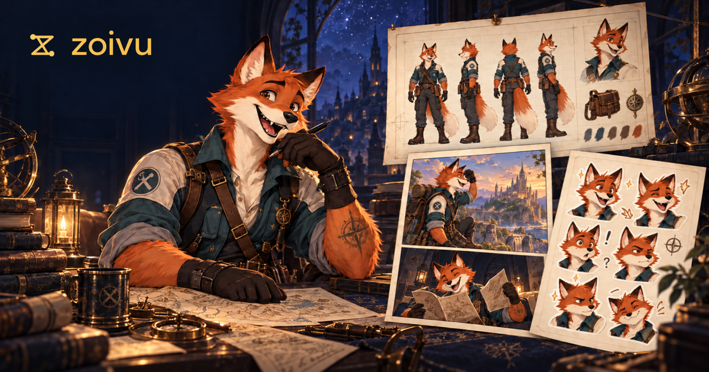
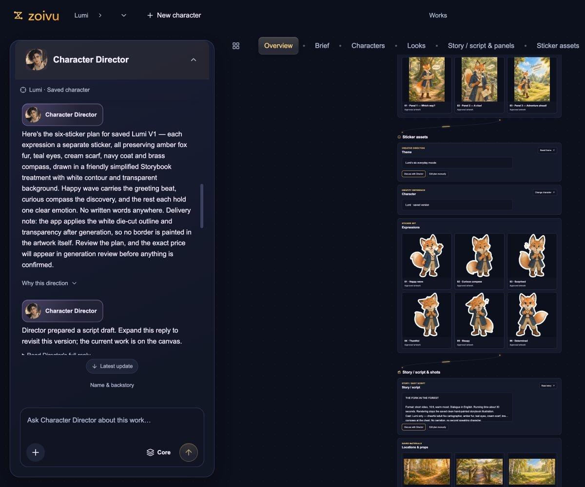
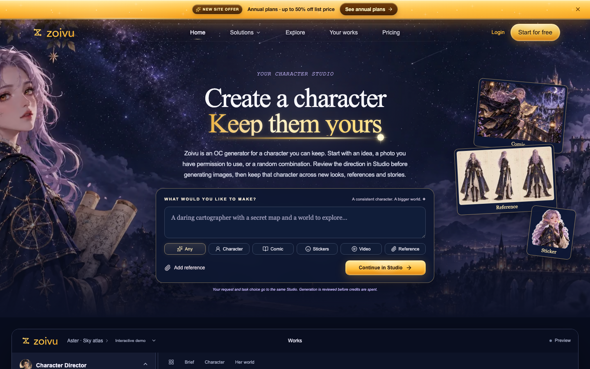
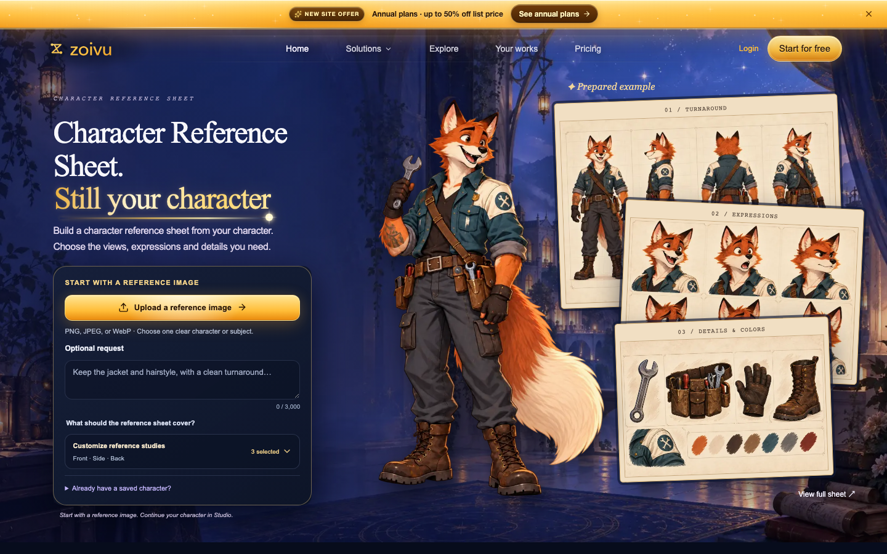

# Zoivu — AI Original Character Studio

[Try Zoivu](https://zoivu.com/) · [Pricing](https://zoivu.com/pricing) · [中文介绍](README.zh-CN.md)

Zoivu helps creators develop original characters and build on them across new looks, reference sheets, comics and stickers. Work with the Character Director in one conversation, with your creative work alongside it on a shared canvas.

*Promotional artwork introducing Zoivu. See the product screenshots below for the actual interface.*

## Create with your character

- **Start from an idea or reference.** Describe an original character, use a photo you have permission to upload, or build a brief with the OC Maker and random character generator.
- **Plan with the Character Director.** Develop character identity, looks and stories in a continuing conversation.
- **Review before generation.** Check the planned direction before creating images.
- **Build a reference sheet.** Explore angles, expressions, poses and turnaround views.
- **Make comics and stickers.** Develop panels with editable dialogue or plan a character sticker pack.

## Inside the Studio

The Character Director stays on the left while character work, story panels and sticker assets appear on the canvas to the right.

*Actual Studio screenshot with a sample character project. Results vary by prompt, references and generation.*

## Product pages

| Workflow | Open Zoivu |
| --- | --- |
| Original characters | [AI Character Generator](https://zoivu.com/ai-character-generator) |
| Character details | [OC Maker](https://zoivu.com/oc-maker) |
| Character briefs | [Random Character Generator](https://zoivu.com/random-character-generator) |
| Reference sheets | [Character Reference Sheet](https://zoivu.com/character-reference-sheet) |
| Comic panels | [AI Comic Generator](https://zoivu.com/ai-comic-generator) |
| Sticker packs | [AI Sticker Generator](https://zoivu.com/ai-sticker-generator) |
| Anime looks | [Anime Character Creator](https://zoivu.com/anime-character-creator) |

### Homepage

### Character reference sheet workflow

## Getting started

1. Visit [zoivu.com](https://zoivu.com/).
2. Choose a character workflow and sign in with Google when prompted.
3. Describe your idea or add a reference you have the rights to use.
4. Review the planned direction in the Studio, then continue creating with your character.

Zoivu offers a free plan with starter credits and paid plans. See the [current pricing page](https://zoivu.com/pricing) for credit limits and availability.

## About this repository

This is Zoivu’s public product guide and screenshot collection. Zoivu is a hosted web application. This repository does not contain the application source code or an installable package.

Screenshots show the product at the time they were captured. Examples illustrate workflows and do not guarantee identical output or perfect character consistency. Zoivu is intended for safe-for-work original characters. Only upload photos and other materials you have permission to use.

## Contact and policies

- Product support: [support@zoivu.com](mailto:support@zoivu.com)
- [Terms](https://zoivu.com/terms)
- [Privacy](https://zoivu.com/privacy)

The Zoivu name, logo, promotional artwork and screenshots remain the property of their respective rights holders. No open-source license is granted for the hosted application by this repository.
