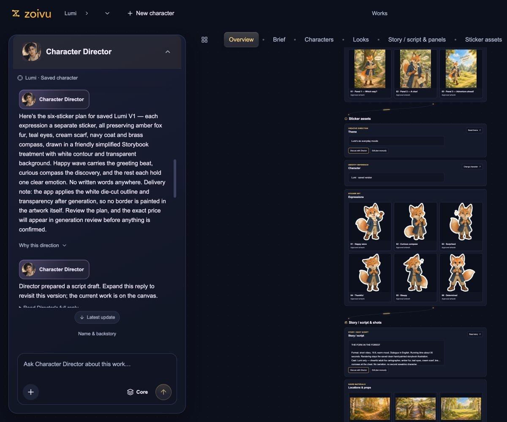

# Zoivu — AI 原创角色创作工作室

[打开 Zoivu](https://zoivu.com/) · [定价](https://zoivu.com/pricing) · [English](README.md)

Zoivu 帮助你创建原创角色，并围绕角色继续制作造型、参考图、漫画和贴纸。左侧 Character Director 持续对话，右侧共享画布展示创作内容。

## 真实 Studio 界面

*真实界面的示例角色项目。生成结果会随提示词、参考资料和模型输出变化。*

## 可以做什么

- 从文字想法、有权使用的照片、OC Maker 或随机角色 brief 开始。
- 和 Character Director 一起规划身份、造型、参考图与故事。
- 生成前先审阅方向。
- 制作多角度、表情、姿势和转面角色参考图。
- 规划漫画分镜、编辑对白，制作角色贴纸包。

## 开始使用

访问 [zoivu.com](https://zoivu.com/)，选择创作流程，按提示使用 Google 登录。在 Studio 审阅方向，再继续创作。免费计划包含起始积分，具体额度、付费方案和可用性以[定价页](https://zoivu.com/pricing)为准。

这是产品介绍与截图仓库。Zoivu 是在线应用，本仓库不提供应用源代码或本地安装包。请仅上传有权使用的素材，角色一致性和生成效果不作保证。

联系：[support@zoivu.com](mailto:support@zoivu.com)。[服务条款](https://zoivu.com/terms) · [隐私政策](https://zoivu.com/privacy)。
